# TrustLine (NPRU Sentinel) - Anonymous Report Portal
ระบบแจ้งเบาะแสและจัดการข้อมูลอย่างเป็นระบบ ปลอดภัย และเข้ารหัส (มหาวิทยาลัยราชภัฏนครปฐม)

---

## 📌 บทนำ (Introduction)
**TrustLine / NPRU Sentinel** เป็นระบบเว็บแอปพลิเคชันสำหรับรับแจ้งเรื่องร้องเรียน เบาะแส และปัญหาภายในมหาวิทยาลัยราชภัฏนครปฐม โดยให้ความสำคัญสูงสุดกับ **ความปลอดภัย ความเป็นนิรนาม (100% Anonymity) และการปกป้องตัวตนของผู้แจ้ง** พร้อมด้วยระบบผู้ช่วยอัจฉริยะ (AI Smart Assistant) ที่ช่วยวิเคราะห์หมวดหมู่ ประเมินระดับความเร่งด่วน สรุปเนื้อหาเบื้องต้น และระบบบริหารจัดการสำนวนคดีสำหรับผู้ดูแลระบบ (Admin) แบบครบวงจร

- 🌐 **เว็บไซต์ระบบจริง (Live Web Application):** [https://anonymous-report.ai.studio](https://anonymous-report.ai.studio)
- 🧪 **เทคโนโลยีทดสอบอัตโนมัติ (Automated E2E Testing):** Selenium Python (Python 3.10+, Selenium WebDriver 4.x, Pytest 8.x/9.x)

---

## ✨ ฟีเจอร์หลักของระบบ (Key Features)

1. **🔒 แจ้งเบาะแสนิรนาม 100% (100% Anonymous Reporting)**
   - ไม่ต้องลงทะเบียนหรือล็อกอิน ไม่เก็บ IP Address หรือข้อมูลระบุตัวตน
   - แนบไฟล์หลักฐาน (ภาพ, เอกสาร) พร้อมระบบตรวจสอบและจำกัดนามสกุลไฟล์ที่ปลอดภัย
   - เข้ารหัส PIN ด้วย SHA-256 เพื่อใช้เข้าถึงรายงาน

2. **🔍 ติดตามสถานะและสนทนาลับ (Track Status & 2-Way Secure Chat)**
   - ผู้แจ้งใช้ **Report ID** (รูปแบบ `TL-xxxx-xxxx`) คู่กับ **PIN 4 หลัก** ในการติดตามสถานะ
   - มีระบบแชทลับโต้ตอบกับเจ้าหน้าที่ผู้รับผิดชอบคดีแบบเรียลไทม์

3. **🛠️ ระบบบริหารจัดการคดีสำหรับเจ้าหน้าที่ (Admin Case Management)**
   - **แก้ไขสำนวนคดี (Full Edit Mode):** ปรับแก้ข้อความรายละเอียด วันที่ สถานที่ หมวดหมู่ และบันทึกช่วยจำภายใน
   - **เปลี่ยนสถานะคดีทันที (Status Selector):** ปรับเปลี่ยนสถานะคดี (รับเรื่องแล้ว, กำลังตรวจสอบ, ดำเนินการทางวินัย, ยุติเรื่อง)
   - **ลบรายงาน (Secure Delete):** มีกล่องยืนยันก่อนลบ ป้องกันการกดลบโดยไม่ได้ตั้งใจ

4. **🐍 สถาปัตยกรรมแบบ Dual Backend**
   - **Full-Stack Node.js (React 19 + TypeScript + Vite + Tailwind CSS + Express + SQLite3 + WebSockets)** บนพอร์ต `3000`
   - **Python Backend Alternative (Flask + SQLite `app.py`, `schema.sql`)** บนพอร์ต `5000`

---

## 🧪 การทดสอบระบบอัตโนมัติด้วย Selenium Python (10 Test Cases)

ชุดทดสอบอัตโนมัติถูกพัฒนาขึ้นด้วย **Selenium Python เท่านั้น** ตามโจทย์ความต้องการ โดยมุ่งเน้นการทดสอบกับเว็บจริง:  
👉 **`https://anonymous-report.ai.studio`**

### 📁 การแยกไฟล์ชุดทดสอบ (10 Separated Test Files)
ชุดทดสอบถูกแยกออกเป็น **10 ไฟล์อิสระ (1 ไฟล์ ต่อ 1 ข้อทดสอบ)** ภายในโฟลเดอร์ `tests/` เพื่อให้อ่านง่าย บำรุงรักษาง่าย และสามารถสั่งรันแยกเฉพาะข้อได้ทันที:

| ลำดับโจทย์ | ไฟล์ทดสอบ | กรณีทดสอบ | ขั้นตอน User Flow | การตรวจสอบความถูกต้องจริงใน Test และการเช็คแจ้งเตือนขั้นตอนสุดท้าย (Final Notification Checks) | ภาพหน้าจอหลักฐาน (Screenshot) |
| :---: | :--- | :--- | :---: | :--- | :--- |
| **1** | [`test_01_login.py`](tests/test_01_login.py) | **login** | Step 7 | กรอกรหัสถูกต้อง (`admin` / `password123`) $\rightarrow$ ตรวจพบปุ่มออกจากระบบ, แถบ Navbar แสดงชื่อ Admin และ**ขั้นตอนสุดท้าย:** เช็ค Modal ปิดลง, ไม่มี error notification และตรวจพบป้ายแจ้งสถานะล็อกอินสำเร็จ | [`01_login_success.png`](screenshots/01_login_success.png) |
| **2** | [`test_02_กรอกแบบฟอร์มและกดส่ง.py`](tests/test_02_กรอกแบบฟอร์มและกดส่ง.py) | **กรอกแบบฟอร์มและกดส่ง** | Step 3 | กรอกสถานที่ + รายละเอียดพร้อม Unique Tag $\rightarrow$ ได้ Report ID + PIN $\rightarrow$ **ขั้นตอนสุดท้าย:** เช็ค Modal แจ้งเตือนส่งสำเร็จ 'ส่งรายงานลับสำเร็จแล้ว!' และข้อความยืนยันการบันทึกรายงาน | [`02_submit_form_success.png`](screenshots/02_submit_form_success.png) |
| **3** | [`test_03_ติดตาม.py`](tests/test_03_ติดตาม.py) | **ติดตาม** | Step 5 | กรอก Report ID และ PIN จริง $\rightarrow$ เข้าสู่หน้ารายละเอียดสำเร็จ $\rightarrow$ **ขั้นตอนสุดท้าย:** เช็คไม่พบแจ้งเตือน error และตรวจพบป้ายแจ้งสถานะคดี (Status Notification Badge เช่น 'รับเรื่องแล้ว') | [`03_track_status_success.png`](screenshots/03_track_status_success.png) |
| **4** | [`test_04_login_ไม่ได้.py`](tests/test_04_login_ไม่ได้.py) | **login ไม่ได้** | Step 6 | กรอกรหัสผ่านผิด $\rightarrow$ **ขั้นตอนสุดท้าย:** เช็คกล่องแจ้งเตือนความล้มเหลว (Error Notification Banner) สีแดง 'ชื่อผู้ใช้หรือรหัสผ่านไม่ถูกต้อง' และไม่ได้รับสิทธิ์แอดมิน | [`04_login_failed_error.png`](screenshots/04_login_failed_error.png) |
| **5** | [`test_05_กรอกฟอมผิด.py`](tests/test_05_กรอกฟอมผิด.py) | **กรอกฟอมผิด** | Step 1 | เว้นว่างรายละเอียดเหตุการณ์ (บล็อกส่งฟอร์ม) $\rightarrow$ แนบไฟล์ `.exe` $\rightarrow$ **ขั้นตอนสุดท้าย:** เช็ค Alert เตือน และกล่องแจ้งเตือนสีแดง 'รูปแบบไฟล์ไม่ถูกต้อง' ปฏิเสธไฟล์จริง | [`05_invalid_form_error.png`](screenshots/05_invalid_form_error.png) |
| **6** | [`test_06_admin_แก้ไข.py`](tests/test_06_admin_แก้ไข.py) | **admin แก้ไข** | Step 8 | Admin ค้นหาเคส $\rightarrow$ แก้ไขบันทึกสำนวน $\rightarrow$ **ขั้นตอนสุดท้าย:** เช็คกล่องข้อความ Toast Notification สีเขียวมุมขวาล่าง 'บันทึกการแก้ไขข้อมูลรายงาน #... สำเร็จแล้ว' | [`06_admin_edit_success.png`](screenshots/06_admin_edit_success.png) |
| **7** | [`test_07_ลบ.py`](tests/test_07_ลบ.py) | **ลบ** | Step 2 | แนบไฟล์รูปภาพในฟอร์ม $\rightarrow$ กดปุ่มถังขยะ $\rightarrow$ **ขั้นตอนสุดท้าย:** เช็คยืนยันว่าชื่อไฟล์และ element ไฟล์แนบถูกลบออกจาก DOM อย่างสมบูรณ์ 100% | [`07_delete_attachment_success.png`](screenshots/07_delete_attachment_success.png) |
| **8** | [`test_08_กรอกติดตามผิด.py`](tests/test_08_กรอกติดตามผิด.py) | **กรอกติดตามผิด** | Step 4 | ค้นหาด้วย Report ID ปลอม หรือ PIN ผิด $\rightarrow$ **ขั้นตอนสุดท้าย:** เช็คกล่องแจ้งเตือนความล้มเหลวสีแดง (Error Box) 'ไม่พบรหัสรายงาน หรือรหัสผ่าน (PIN) ไม่ถูกต้อง' | [`08_invalid_tracking_error.png`](screenshots/08_invalid_tracking_error.png) |
| **9** | [`test_09_admin_ลบ.py`](tests/test_09_admin_ลบ.py) | **admin ลบ** | Step 10 | Admin กดลบคดี $\rightarrow$ กดยืนยัน $\rightarrow$ เช็ค Toast ลบสำเร็จ $\rightarrow$ **ขั้นตอนสุดท้าย:** Cross-check ฝั่งผู้แจ้ง ค้นหาแล้วต้องพบแจ้งเตือนสีแดง 'ไม่พบรหัสรายงาน' ยืนยันว่าคดีถูกลบจริง | [`09_admin_delete_success.png`](screenshots/09_admin_delete_success.png) |
| **10** | [`test_10_admin_เปลี่ยน.py`](tests/test_10_admin_เปลี่ยน.py) | **admin เปลี่ยน** | Step 9 | Admin เปลี่ยนสถานะ $\rightarrow$ เช็ค Toast แจ้งอัปเดตสถานะ $\rightarrow$ **ขั้นตอนสุดท้าย:** Cross-check ฝั่งผู้แจ้ง ค้นหาแล้วต้องพบป้ายแจ้งสถานะใหม่ 'ดำเนินการทางวินัย' เปลี่ยนตามจริง | [`10_admin_change_status_success.png`](screenshots/10_admin_change_status_success.png) |

---

### 🔄 ลำดับการรันตาม User Flow Lifecycle
เมื่อสั่งรันชุดทดสอบทั้งหมด สคริปต์ `run_10_tests.py` จะร้อยเรียงการทำงานตามเส้นทางของผู้ใช้งานจริง (User Journey Lifecycle):

```mermaid
flowchart LR
    subgraph Whistleblower ["1. ฝั่งผู้แจ้งเบาะแส"]
        S1["Step 1: กรอกฟอมผิด (ข้อ 5)"] --> S2["Step 2: ลบไฟล์แนบ (ข้อ 7)"]
        S2 --> S3["Step 3: กรอกฟอร์มและกดส่ง (ข้อ 2)"]
    end

    subgraph Tracking ["2. การติดตามสถานะ"]
        S3 --> S4["Step 4: กรอกติดตามผิด (ข้อ 8)"]
        S4 --> S5["Step 5: ติดตามด้วยรหัสจริง (ข้อ 3)"]
    end

    subgraph Admin ["3. ฝั่งเจ้าหน้าที่ดูแลระบบ"]
        S5 --> S6["Step 6: Login ไม่ได้ (ข้อ 4)"]
        S6 --> S7["Step 7: Login สำเร็จ (ข้อ 1)"]
        S7 --> S8["Step 8: Admin แก้ไขสำนวน (ข้อ 6)"]
        S8 --> S9["Step 9: Admin เปลี่ยนสถานะ (ข้อ 10)"]
        S9 --> S10["Step 10: Admin ลบคดี (ข้อ 9)"]
    end
```


---

## 💻 วิธีการติดตั้งและรันการทดสอบ (Getting Started)

### 1. ติดตั้ง Python และ Dependencies
ต้องใช้ **Python 3.10 ขึ้นไป** และมี Google Chrome ติดตั้งอยู่ในเครื่อง:

```bash
# ติดตั้ง Packages ที่จำเป็นสำหรับ Selenium & Pytest
pip install -r requirements.txt
```

*(รายการ Dependencies ใน `requirements.txt`: `selenium>=4.20.0`, `pytest>=8.0.0`, `pytest-html>=4.0.0`, `webdriver-manager>=4.0.0`)*

---

### 2. คำสั่งการรันการทดสอบผ่าน `run_10_tests.py` (แนะนำ)

สคริปต์ [run_10_tests.py](run_10_tests.py) มาพร้อมระบบสรุปผลภาษาไทย รองรับทั้งการรันครบ 10 ข้อ หรือเจาะจงเฉพาะข้อ:

#### ⚡ 2.1 รันครบทั้ง 10 ไฟล์ตาม User Flow (โหมด Headless ความเร็วสูง)
```powershell
python run_10_tests.py
```

#### 🖥️ 2.2 รันครบทั้ง 10 ไฟล์แบบเปิดหน้าต่าง Chrome จริง (Headed Mode)
เปิดหน้าต่าง Google Chrome ให้เห็นการทำงาน เมาส์คลิก และการกรอกข้อมูลแบบเรียลไทม์:
```powershell
python run_10_tests.py --headed
```

#### 🎯 2.3 รันเฉพาะข้อที่ต้องการ (เลือกได้ตั้งแต่ 1 ถึง 10)
สามารถระบุตัวเลือก `--case <หมายเลข>` เพื่อรันเฉพาะข้อใดข้อหนึ่งได้อย่างรวดเร็ว:
```powershell
# รันข้อ 1: login
python run_10_tests.py --case 1

# รันข้อ 2: กรอกแบบฟอร์มและกดส่ง
python run_10_tests.py --case 2

# รันข้อ 3: ติดตาม
python run_10_tests.py --case 3

# รันข้อ 4: login ไม่ได้
python run_10_tests.py --case 4

# รันข้อ 5: กรอกฟอมผิด
python run_10_tests.py --case 5

# รันข้อ 6: admin แก้ไข
python run_10_tests.py --case 6

# รันข้อ 7: ลบ
python run_10_tests.py --case 7

# รันข้อ 8: กรอกติดตามผิด
python run_10_tests.py --case 8

# รันข้อ 9: admin ลบ
python run_10_tests.py --case 9

# รันข้อ 10: admin เปลี่ยน
python run_10_tests.py --case 10
```

#### 🌐 2.4 เปลี่ยน URL เป้าหมายในการทดสอบ
หากต้องการนำไปยิงทดสอบกับ Localhost ของตนเอง:
```powershell
python run_10_tests.py --url http://localhost:3000
```

---

### 3. คำสั่งการรันผ่าน `pytest` โดยตรง

แต่ละไฟล์ได้รับการออกแบบให้เป็นอิสระต่อกัน (Self-contained) จึงสามารถสั่งรันด้วย `pytest` ทีละไฟล์หรือพร้อมกันได้ทันที:

```powershell
# รันทีละไฟล์แบบละเอียด (-v):
python -m pytest tests/test_01_login.py -v
python -m pytest "tests/test_02_กรอกแบบฟอร์มและกดส่ง.py" -v
python -m pytest "tests/test_03_ติดตาม.py" -v
python -m pytest "tests/test_04_login_ไม่ได้.py" -v
python -m pytest "tests/test_05_กรอกฟอมผิด.py" -v
python -m pytest "tests/test_06_admin_แก้ไข.py" -v
python -m pytest "tests/test_07_ลบ.py" -v
python -m pytest "tests/test_08_กรอกติดตามผิด.py" -v
python -m pytest "tests/test_09_admin_ลบ.py" -v
python -m pytest "tests/test_10_admin_เปลี่ยน.py" -v

# รันไฟล์รวมแบบต่อเนื่อง All-in-One:
python -m pytest tests/test_portal_10_cases.py -v
```

---

## 📊 สรุปผลการทดสอบจริง (Execution Results)

ผลการทดสอบล่าสุดกับเว็บไซต์จริง **`https://anonymous-report.ai.studio`**:

```text
================================================================================================
  🚀 TrustLine / NPRU Sentinel - Automated 10 Separated Files Selenium Test Runner
================================================================================================
  🌐 Target Web URL : https://anonymous-report.ai.studio
  ⚙️ Execution Mode : ⚡ Headless (ทำงานเบื้องหลังความเร็วสูง)
  🔄 Flow Strategy  : Sequential User Journey (Whistleblower Flow -> Admin Flow)
  📁 Test Suite     : 10 Individual Test Files (แยก 1 ไฟล์ ต่อ 1 ข้อทดสอบ)
  🔍 Verification   : Real UI Assertions & Real-Time Cross-Checks On Both Sides
================================================================================================
  📊 สรุปผลการทดสอบไฟล์แยกทั้ง 10 ข้อ (Separated 10 Test Cases Summary)
================================================================================================
  ขั้นตอน  กรณีทดสอบ              หัวข้อ   การตรวจสอบความถูกต้องจริงใน Test           ผลลัพธ์   
------------------------------------------------------------------------------------------------
  Step 1   กรอกฟอมผิด             ข้อ 5    เช็คการบล็อกส่งฟอร์มเปล่า & เช็คการปฏิเสธไฟล์ .exe จริง ✅ ผ่าน (PASS)
  Step 2   ลบ                     ข้อ 7    เช็คการแนบไฟล์ภาพแล้วกดลบออก ไฟล์หายไปจริง 100% ✅ ผ่าน (PASS)
  Step 3   กรอกแบบฟอร์มและกดส่ง   ข้อ 2    เช็คการส่งสำเร็จ ได้ Report ID และ PIN 4 หลักจริง ✅ ผ่าน (PASS)
  Step 4   กรอกติดตามผิด          ข้อ 8    เช็คการแจ้งเตือนสีแดงเมื่อกรอกรหัสติดตามหรือ PIN ผิด ✅ ผ่าน (PASS)
  Step 5   ติดตาม                 ข้อ 3    เช็คการติดตามด้วยรหัสจริง ข้อมูลตรงกับที่กรอก 100% ✅ ผ่าน (PASS)
  Step 6   login ไม่ได้           ข้อ 4    เช็คการแจ้งเตือนรหัสผ่านผิด & ไม่ให้สิทธิ์แอดมิน ✅ ผ่าน (PASS)
  Step 7   login                  ข้อ 1    เช็คเข้าสู่ระบบ admin สำเร็จ ปลดล็อกเมนูจัดการรายงาน ✅ ผ่าน (PASS)
  Step 8   admin แก้ไข            ข้อ 6    เช็ค Admin แก้ไขสำนวนคดีและบันทึกข้อมูลสำเร็จ ✅ ผ่าน (PASS)
  Step 9   admin เปลี่ยน          ข้อ 10   เช็ค Admin เปลี่ยนสถานะคดี & Cross-check ฝั่งผู้แจ้งเปลี่ยนตามจริง ✅ ผ่าน (PASS)
  Step 10  admin ลบ               ข้อ 9    เช็ค Admin ยืนยันลบคดี & Cross-check คดีหายไปจากระบบจริง ✅ ผ่าน (PASS)
------------------------------------------------------------------------------------------------
  สรุปรวม: ผ่าน 10/10 ไฟล์ | ล้มเหลว 0/10 ไฟล์ | สถานะ: All Passed 100% 🎉
================================================================================================
```

---

## 🚀 วิธีการรันโปรเจกต์เว็บในเครื่อง (Running the Portal Locally)

หากต้องการเปิดเซิร์ฟเวอร์ Local ขึ้นมาใช้งานหรือทดสอบ:

### แบบที่ 1: Node.js Full-Stack (แนะนำ)
```bash
# 1. ติดตั้ง Node Dependencies
npm install

# 2. บิลด์โปรเจกต์
npm run build

# 3. เริ่มต้นรันเซิร์ฟเวอร์ Production
npm start
```
เปิดใช้งานได้ทันทีที่: **`http://localhost:3000`**

### แบบที่ 2: Python Flask Backend
```bash
# ติดตั้ง Flask
pip install flask flask-cors

# เริ่มรันแอปพลิเคชัน Python
python app.py
```
เปิดใช้งานได้ที่: **`http://localhost:5000`**

---

## 🔑 บัญชีผู้ใช้สำหรับทดสอบระบบ (Default Test Credentials)

| บทบาท (Role) | Username | Password | สิทธิ์การเข้าถึง |
|---|---|---|---|
| **ผู้ดูแลระบบ (Admin)** | `admin` | `password123` (หรือ `admin123`) | แก้ไขข้อมูลได้ทุกส่วน, ปรับเปลี่ยนสถานะคดี, ยืนยันลบรายงาน, ดูแดชบอร์ด |
| **เจ้าหน้าที่สอบสวน (Officer)** | `officer1` | `officer123` | ตรวจสอบข้อเท็จจริง, แชทลับกับผู้แจ้ง, ปรับปรุงสถานะ |

---

## 📂 โครงสร้างไดเรกทอรีโปรเจกต์ (Project Directory Structure)

```text
├── README.md                           # คู่มือการใช้งานและเอกสารการทดสอบฉบับสมบูรณ์
├── requirements.txt                    # รายการ Dependencies สำหรับ Selenium Python
├── run_10_tests.py                     # สคริปต์รันเนอร์หลัก รองรับทั้ง 10 ข้อและเลือกรันรายข้อ
├── server.ts                           # Express Backend Server + Gemini AI API Proxy
├── app.py                              # Python Flask Alternative Backend
├── schema.sql                          # โครงสร้างฐานข้อมูล SQLite
├── package.json                        # รายการ Dependencies ของฝั่ง Web Application
├── src/                                # ซอร์สโค้ด React Frontend (TypeScript + Tailwind)
├── screenshots/                        # โฟลเดอร์บันทึกภาพหน้าจอหลักฐานอัตโนมัติ (10 PNGs)
│   ├── 01_login_success.png
│   ├── 02_submit_form_success.png
│   ├── 03_track_status_success.png
│   ├── 04_login_failed_error.png
│   ├── 05_invalid_form_error.png
│   ├── 06_admin_edit_success.png
│   ├── 07_delete_attachment_success.png
│   ├── 08_invalid_tracking_error.png
│   ├── 09_admin_delete_success.png
│   └── 10_admin_change_status_success.png
└── tests/                              # โฟลเดอร์ชุดทดสอบ Selenium Python
    ├── conftest.py                     # WebDriver Fixture และ Pytest Configuration
    ├── helpers.py                      # ฟังก์ชันช่วยเหลือส่วนกลางและการเตรียมข้อมูลทดสอบ
    ├── .test_state.json                # ไฟล์บันทึกข้อมูล Report ID / PIN ระหว่างการทดสอบ
    ├── test_01_login.py                # ข้อ 1: login
    ├── test_02_กรอกแบบฟอร์มและกดส่ง.py # ข้อ 2: กรอกแบบฟอร์มและกดส่ง
    ├── test_03_ติดตาม.py               # ข้อ 3: ติดตาม
    ├── test_04_login_ไม่ได้.py         # ข้อ 4: login ไม่ได้
    ├── test_05_กรอกฟอมผิด.py           # ข้อ 5: กรอกฟอมผิด
    ├── test_06_admin_แก้ไข.py          # ข้อ 6: admin แก้ไข
    ├── test_07_ลบ.py                   # ข้อ 7: ลบ
    ├── test_08_กรอกติดตามผิด.py        # ข้อ 8: กรอกติดตามผิด
    ├── test_09_admin_ลบ.py             # ข้อ 9: admin ลบ
    ├── test_10_admin_เปลี่ยน.py        # ข้อ 10: admin เปลี่ยน
    └── test_portal_10_cases.py         # ชุดทดสอบรวมแบบต่อเนื่อง (All-in-One E2E)
```

---

## ⚖️ ลิขสิทธิ์และการใช้งาน (License)
พัฒนาขึ้นสำหรับ **มหาวิทยาลัยราชภัฏนครปฐม (Nakhon Pathom Rajabhat University - NPRU)** เพื่อเป็นระบบแจ้งเบาะแสและร้องเรียนที่โปร่งใส ตรวจสอบได้ และรักษาความลับของผู้ร้องเรียนตามมาตรฐานจริยธรรมและ พ.ร.บ. คุ้มครองข้อมูลส่วนบุคคล (PDPA)
